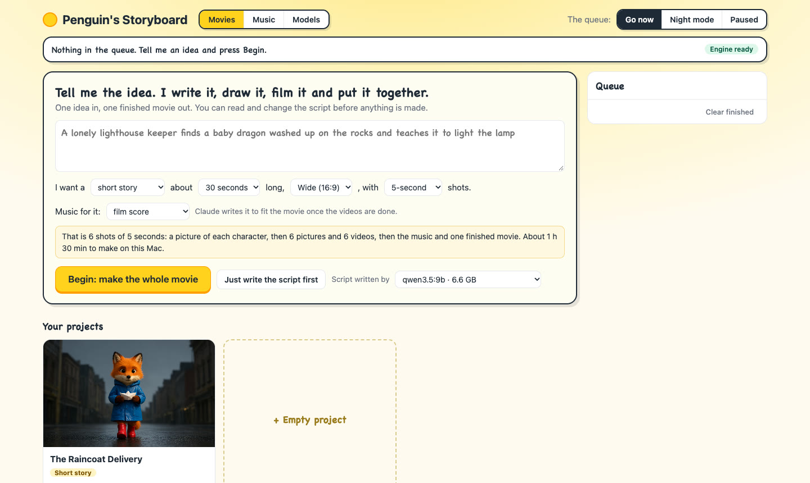
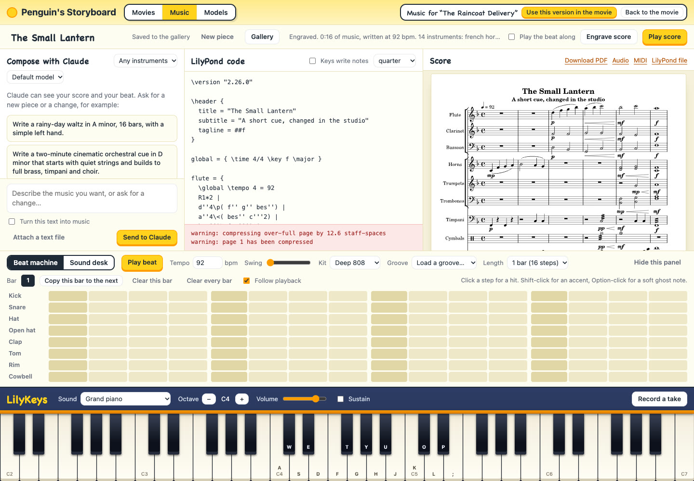

# Penguin's Storyboard

One idea in, one finished movie out, made on your own Mac.

You type what the movie is about. A writing model on your computer writes the script, an image model draws
every shot, a video model films it, Claude composes music to its exact length, and the app joins it all into
one file with sound. You can read and change everything along the way, or press one button and come back later.



It runs entirely on your machine and opens in your browser. Nothing is uploaded, with three exceptions that
are listed under [What goes online](#what-goes-online).

## The three sections

**Movies.** The storyboard. Describe an idea, pick a length, and the script writer fills in the look, the
characters and every shot: what the picture shows, how the video moves, and a line of narration. Each character
gets a picture of their own and every shot they are in is drawn from it, so they stay the same from shot to
shot. Everything you ask for lines up in one queue. Night mode holds the queue until a time you choose and
then works through it while you sleep, keeping the Mac awake.


**Music.** A music studio (it began as an app of its own, LilyKeys): a playable piano, a score editor that
engraves sheet music, a drum machine, a sampled orchestra and band, and Claude as a composing partner. When a
movie's videos are done, Claude writes a cue that is exactly as long as the movie, at a tempo where the picture
cuts land on bar lines. Open the score in the studio to change it by hand or with Claude, then send it back to
the movie with one button. Any piece can be saved as an audio file.



**Models.** The picture and video models are big files that do not come with the app. The Models page lists
what the movie maker needs as kits, downloads them with one click each, and tells you what is still missing.
It also has a general Hugging Face downloader that explains a model in plain English before you download it,
and lets you use a different file of the same model family in place of a kit's. A model from another family
can be downloaded, but the movie maker only knows how to drive the families its kits are made of.


## What you need

- An Apple Silicon Mac. This was built and tested on one Mac mini (M4, 24 GB of memory). It has not been run
  on Intel Macs, Windows or Linux.
- 24 GB of memory or more. The video model runs right at that limit.
- About 65 GB of free disk space: roughly 40 GB for the picture and video models, 7 GB for the writing model
  and 5 GB for the engine.
- For music: a [Claude Code](https://claude.com/claude-code) sign-in (Claude composes) and Chrome, Chromium,
  Edge or Brave (one of them plays the score into an audio file, out of sight). Everything else works without them.

## Install

```bash
git clone https://github.com/lalomorales22/penguin-movie-studio.git
cd penguin-movie-studio
./setup.command
```

Or double-click `setup.command` in Finder. It installs what is missing and leaves the rest alone:
[Homebrew](https://brew.sh), ffmpeg, [LilyPond](https://lilypond.org), [uv](https://docs.astral.sh/uv/),
[Ollama](https://ollama.com), the picture and video engine ([ComfyUI](https://github.com/comfyanonymous/ComfyUI),
at the version this app was tested with) and, if you want music, Claude Code. `./setup.command --check` only
reports what is there.

Then double-click `Start Storyboard.command`. The app opens at http://127.0.0.1:8777. Go to **Models** and
download the kits; the buttons on the other pages switch on as their kits arrive.

If macOS says a `.command` file cannot be opened because it was downloaded from the internet, right-click it
and choose Open.

## How long things take

Measured on a Mac mini (M4, 24 GB), at 832x480 for video:

| Job | Time |
| --- | --- |
| Script for a 30-second movie | under a minute |
| A character's picture, or a shot's picture | about 4 minutes |
| A shot's picture drawn from character pictures | about 5 minutes |
| A 5-second video (Fast) | about 11 minutes |
| A 5-second video (best quality) | several times longer |
| Music for a short movie | about 2 minutes |
| Joining the movie | seconds |

A 30-second movie (six 5-second shots) is about an hour and a half of work for the Mac, which is what Night
mode is for.

## What goes online

- **Model downloads.** The Models page downloads from Hugging Face, and the script writer's model from Ollama's
  library, when you press a download button.
- **Composing.** Music is written by Claude through your own Claude Code sign-in. For a movie, the app sends
  the length, the tempo and a few mood words per shot (written by the local model: "quiet, curious, slow"),
  plus anything you type in the music note. The script itself is not sent. In the Music studio, what you type
  to Claude and the score you are working on are sent, as in any chat with Claude.
- **Instrument sounds.** The sampled instruments (about 140 MB for the orchestra and band) come from
  `gleitz.github.io`, as a kit or the first time a score uses one.

The app listens on `127.0.0.1` only, so other devices on your network cannot reach it. Sheet-music files can
run code, so do not expose it to a network.

## Where things are

| Path | What it is |
| --- | --- |
| `storyboard/app.py` | The app: the web server, the projects, the queue, Night mode, and the conversations with ComfyUI and Ollama. |
| `storyboard/index.html` | The Movies page. |
| `storyboard/music.py`, `storyboard/music/` | The Music section: engraving, composing, the gallery, audio files, and the studio pages. |
| `storyboard/models.py`, `storyboard/models.html` | The Models section: kits, the downloader, and which file each job uses. |
| `storyboard/comfy_nodes/` | A small ComfyUI node the app installs for GGUF prompt readers. |
| `setup.command`, `Start Storyboard.command` | The installer and the launcher. |
| `ComfyUI/` | The engine, put there by setup. Never committed. |
| `storyboard/data/` | Your projects, movies, music, settings and downloaded sounds. Never committed. |

The server is Python's standard library, run by the Python that setup installs for ComfyUI. There is nothing
to `pip install` for the app itself.

## Good to know

- The video model makes at most 5 seconds in one go. Longer shots are made in 5-second parts, each starting on
  the last frame of the one before, and joined.
- Character pictures keep distinctive characters very close from shot to shot. The video model can still let
  a character drift during a clip.
- The Fast video kit finishes with one step on your own Mac (about 10 GB is written) the first time.
- The installer has only been run on a Mac that already had everything, so a first install on a clean Mac is
  the least tested part. Reports and fixes are welcome.

## Licences and credits

The app itself is under the [MIT licence](LICENSE). It installs and drives other people's work, each under
its own terms:

- [ComfyUI](https://github.com/comfyanonymous/ComfyUI) (GPL-3.0) is the picture and video engine. Setup
  downloads it; it is not part of this repository.
- The models are downloaded by you from their publishers on Hugging Face and are under their own licences.
  Read them before you use what you make commercially. In particular, the Qwen-Image 2.1 files are published
  under a research licence.
- Music engraving by [LilyPond](https://lilypond.org).
- Grand piano: Salamander Grand Piano by Alexander Holm, [CC BY 3.0](https://creativecommons.org/licenses/by/3.0/).
  See `storyboard/music/samples/README.md`.
- Orchestra and band instruments: FluidR3 GM soundfont by Frank Wen (MIT licence), as packaged by
  [midi-js-soundfonts](https://github.com/gleitz/midi-js-soundfonts).
- The penguin on the Models page is drawn with [three.js](https://threejs.org) (MIT licence), bundled in
  `storyboard/vendor/`.

This project is not affiliated with Hugging Face, Anthropic, Ollama or the makers of the models.
