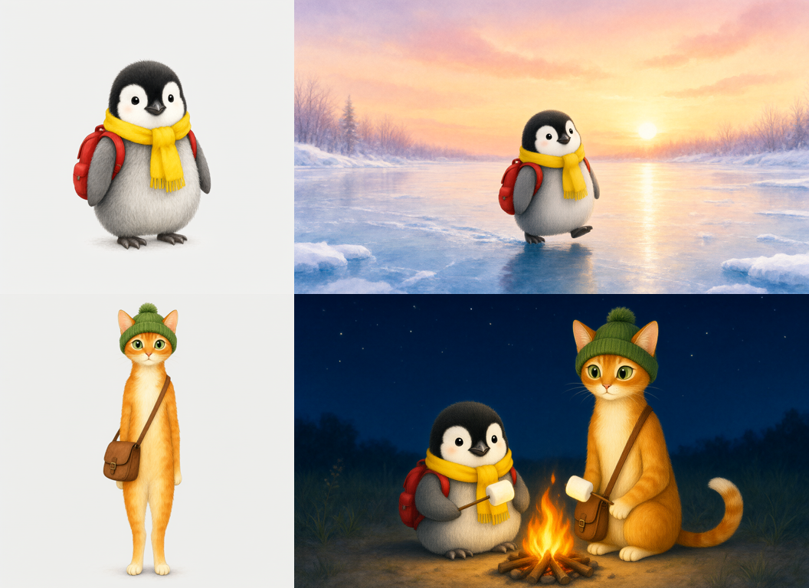
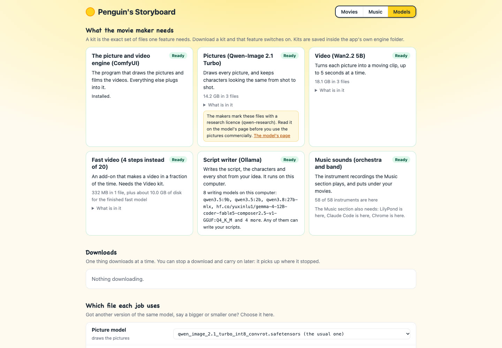

# Penguin's Storyboard

One idea in, one finished movie out, made on your own Mac.

You type what the movie is about. A writing model on your computer writes the script, an image model draws
every shot, a video model films it, Claude composes music to its exact length, and the app joins it all into
one file with sound. You can read and change everything along the way, or press one button and come back later.


It runs entirely on your machine and opens in your browser. Nothing is uploaded, with three exceptions that
are listed under [What goes online](#what-goes-online).

## The three sections

**Movies.** The storyboard. Describe an idea, pick a length, and the script writer fills in the look, the
characters and every shot: what the picture shows, how the video moves, and a line of narration. Each character
gets a picture of their own and every shot they are in is drawn from it, so they stay the same from shot to
shot. Everything you ask for lines up in one queue. Night mode holds the queue until a time you choose and
then works through it while you sleep, keeping the Mac awake.



**Music.** A music studio (it began as an app of its own, LilyKeys): a playable piano, a score editor that
engraves sheet music, a drum machine, 128 sampled instruments, and Claude as a composing partner. When a
movie's videos are done, Claude writes a cue that is exactly as long as the movie, at a tempo where the picture
cuts land on bar lines. Open the score in the studio to change it by hand or with Claude, then send it back to
the movie with one button. Any piece can be saved as an audio file.

The score is played the way it is written. Soft and loud are really soft and loud, a held chord under a
crescendo swells, an accent bites, and a roll on a drum or a cymbal is a real roll that follows the hairpin
over it. The string staves of an orchestra sound like sections, every instrument has a seat on the stage, and
the whole thing sits in a room, a concert hall or a cathedral. Under the instruments Claude can lay film
sounds: drones, risers, deep hits, a heartbeat, a ticking pulse, wind, rain, the sea, bells, thunder. They are
all made by the app itself, so there is nothing to download for them, and one box switches them off.

Three extras, each a kit of its own on the Models page. **Recorded drums and percussion** put real recordings
in place of the drums the app makes itself: seven drum kits for the drum machine and for scores, an orchestra's
percussion (concert bass drum, snare, cymbals, tam-tam, triangle), hand percussion, and recorded film sounds
(a gong, a cymbal swell, a huge drum, wind chimes, a bowed cymbal). The other two make sound itself instead of
a score: **a song with singing**, written and sung on your computer as the movie's music, and **the sounds of
each shot** (footsteps, rain, traffic), made from a sentence about what is heard there and mixed under the music.


**Models.** The picture and video models are big files that do not come with the app. The Models page lists
what the movie maker needs as kits, downloads them with one click each, and tells you what is still missing.
It also has a general Hugging Face downloader that explains a model in plain English before you download it,
and lets you use a different file of the same model family in place of a kit's. A model from another family
can be downloaded, but the movie maker only knows how to drive the families its kits are made of.



## What you need

- An Apple Silicon Mac. This was built and tested on one Mac mini (M4, 24 GB of memory). It has not been run
  on Intel Macs or Linux. For Windows there is a first, experimental version: see [Windows](#windows-experimental).
- 24 GB of memory or more. The video model runs right at that limit.
- About 65 GB of free disk space. A complete install measured 55 GB: 43 GB for the picture and video models,
  7 GB for the writing model and 5 GB for the engine and its tools. The rest is room to work. The extra kits
  are not counted in that: songs with singing is 10 GB more, the sounds of each shot 3.5 GB, the recorded drums
  0.2 GB.
- For music: a [Claude Code](https://claude.com/claude-code) sign-in (Claude composes) and Chrome, Chromium,
  Edge or Brave (one of them plays the score into an audio file, out of sight). Everything else works without them.

## Install

```bash
git clone https://github.com/lalomorales22/penguin-movie-studio.git
cd penguin-movie-studio
./setup.command
```

Or double-click `setup.command` in Finder. It installs what is missing and leaves the rest alone:
[Homebrew](https://brew.sh), ffmpeg, [LilyPond](https://lilypond.org), [uv](https://docs.astral.sh/uv/),
[Ollama](https://ollama.com), the picture and video engine ([ComfyUI](https://github.com/comfyanonymous/ComfyUI),
at the version this app was tested with) and, if you want music, Claude Code. `./setup.command --check` only
reports what is there.

Then double-click `Start Storyboard.command`. The app opens at http://127.0.0.1:8777. Go to **Models** and
download the kits (about 33 GB, a quarter of an hour on a fast connection), then press **Finish setting up
Fast video** on that page. The buttons on the other pages switch on as their kits arrive.

If you downloaded the ZIP from GitHub instead of using `git clone`, macOS may refuse to open the `.command`
files because they came from the internet. Either allow each one under System Settings → Privacy & Security
→ Open Anyway, or clear the mark for the whole folder once, in Terminal, from inside the folder:

```bash
xattr -dr com.apple.quarantine .
```

## Windows (experimental)

The app was built on a Mac. The Windows version is new: it was written without a Windows PC at hand, and nobody
has made a picture or a video with it on Windows yet. If you try it, please
[open an issue](https://github.com/lalomorales22/penguin-movie-studio/issues) and say what happened and which
graphics card you have.

What you need: Windows 10 or 11, an NVIDIA graphics card with a current driver, and the same disk space as on a
Mac. The models were chosen for 24 GB of memory. A card with 24 GB should hold them; with 12 to 16 GB the engine
keeps part of each model in normal memory, which is slower (32 GB of normal memory is safer then). None of that
has been measured. Cards from AMD and Intel are not set up.

1. Get the folder: `git clone` it, or download the ZIP from GitHub and unpack it. A short path without accents,
   such as `C:\penguin-movie-studio`, avoids trouble.
2. Double-click `setup.bat`. It installs what is missing with winget (git, ffmpeg, uv, Ollama, the Microsoft
   Visual C++ runtime), downloads LilyPond into the app's own `tools` folder, sets up the engine with the PyTorch
   build for NVIDIA cards and, if you want music, installs Claude Code. `setup.bat -Check` only reports what is
   there. Windows may warn that the file came from the internet: choose More info, then Run anyway.
3. Double-click `Start Storyboard.bat`. From there everything is as described above: open **Models**, download
   the kits, press **Finish setting up Fast video**.

For an NVIDIA card older than the 20 series, ComfyUI asks for an older PyTorch build:
`setup.bat -TorchIndex cu126 -PythonVersion 3.12`.

What is checked on Windows: `windows/check.py` starts the app on throw-away data and tries everything that
needs no graphics card: the pages, LilyPond, turning a score into an audio file in a hidden browser, joining
clips with ffmpeg, starting the engine. GitHub's Windows machines run the installer and then that check after
every change to the Windows version (the Actions tab shows the last run). What is not checked: drawing pictures,
filming clips, songs, the sounds of the shots, and how long anything takes.

## How long things take

Measured on a Mac mini (M4, 24 GB), at 832x480 for video:

| Job | Time |
| --- | --- |
| Script for a 30-second movie | under a minute |
| A character's picture, or a shot's picture | about 4 minutes |
| A shot's picture drawn from character pictures | about 5 minutes |
| A 5-second video (Fast) | about 11 minutes |
| A 5-second video (best quality) | several times longer |
| Music for a short movie | about 2 minutes |
| A song with singing for a one-minute movie | about 2 and a half minutes |
| The sounds of the shots of a one-minute movie | about a minute and a half |
| Joining the movie | seconds |

A 30-second movie (six 5-second shots) is about an hour and a half of work for the Mac, which is what Night
mode is for.

## What goes online

- **Model downloads.** The Models page downloads from Hugging Face, and the script writer's model from Ollama's
  library, when you press a download button.
- **Composing.** Music is written by Claude through your own Claude Code sign-in. For a movie, the app sends
  the length, the tempo and a few mood words per shot (written by the local model: "quiet, curious, slow"),
  plus anything you type in the music note. The script itself is not sent. In the Music studio, what you type
  to Claude and the score you are working on are sent, as in any chat with Claude.
- **Instrument sounds.** The sampled instruments (about 310 MB for all 128) come from `gleitz.github.io`,
  as a kit. Claude is only offered the instruments that are on your computer. The recorded drums (136 MB) come
  from two repositories on GitHub, also as a kit.

A song with singing and the sounds of each shot are made entirely on your computer: the words and the
descriptions are written by the local writing model, and nothing about them is sent anywhere.

The app listens on `127.0.0.1` only, so other devices on your network cannot reach it. Sheet-music files can
run code, so do not expose it to a network.

## Where things are

| Path | What it is |
| --- | --- |
| `storyboard/app.py` | The app: the web server, the projects, the queue, Night mode, and the conversations with ComfyUI and Ollama. |
| `storyboard/index.html` | The Movies page. |
| `storyboard/music.py`, `storyboard/music/` | The Music section: engraving, composing, the gallery, audio files, and the studio pages. |
| `storyboard/percussion.py` | The recorded drums: fetches the recordings and cuts them into the sounds the studio plays. |
| `storyboard/models.py`, `storyboard/models.html` | The Models section: kits, the downloader, and which file each job uses. |
| `storyboard/comfy_nodes/` | Two small ComfyUI nodes the app installs: one for GGUF prompt readers, one that turns generated audio into sound. |
| `setup.command`, `Start Storyboard.command` | The installer and the launcher. |
| `setup.bat`, `Start Storyboard.bat`, `windows/` | The same two for Windows (experimental), the scripts they run, and `windows/check.py`, which tries the app without a graphics card. |
| `Start ComfyUI.command` | Opens the engine's own interface, if you are curious. The app never needs it. |
| `ComfyUI/` | The engine, put there by setup. Never committed. |
| `storyboard/data/` | Your projects, movies, music, settings and downloaded sounds. Never committed. |

The server is Python's standard library, run by the Python that setup installs for ComfyUI. There is nothing
to `pip install` for the app itself.

## Good to know

- The video model makes at most 5 seconds in one go. Longer shots are made in 5-second parts, each starting on
  the last frame of the one before, and joined.
- Character pictures keep distinctive characters very close from shot to shot. The video model can still let
  a character drift during a clip.
- The Fast video kit finishes with one step on your own Mac (about 10 GB is written) the first time.
- How the music sounds was set by measuring recordings (loudness over time, tone, width), not by ear, so the
  balance between instruments is a starting point. The knobs on the Sound desk are there to change it.
- Songs with singing and the sounds of each shot are new. Both ran on the test Mac, from the first word to the
  finished movie, and what they made was checked by measurement (length, loudness, where the energy sits), which
  says a rain sound is a rain sound but not whether a song is a good one. The words of a song and the
  descriptions of the sounds are written by the local writing model; every shot has a box where you can say
  what is heard there yourself.
- On a Mac, ComfyUI runs the audio decoder of the sound-effects model in a number format in which it gives
  noise. The app's own node (`storyboard/comfy_nodes/storyboard_audio.py`) decodes in another, and the sounds
  come out right. If you drive that model from ComfyUI's own pages on a Mac, you will meet this.
- The recorded drums were balanced the same way as everything else here: by measurement against the drums the
  app makes itself.
- A first install was tested from a fresh copy of this repository: setup, every kit downloaded through the
  Models page, the Fast video step, then a one-minute movie with music. That test ran on a Mac that already
  had Homebrew, ffmpeg, LilyPond, uv, Ollama and Claude Code, so the parts of setup that install those have
  not been run. Reports and fixes are welcome.

## Licences and credits

The app itself is under the [MIT licence](LICENSE). It installs and drives other people's work, each under
its own terms:

- [ComfyUI](https://github.com/comfyanonymous/ComfyUI) (GPL-3.0) is the picture and video engine. Setup
  downloads it; it is not part of this repository.
- The models are downloaded by you from their publishers on Hugging Face and are under their own licences.
  Read them before you use what you make commercially. In particular, the Qwen-Image 2.1 files are published
  under a research licence.
- Music engraving by [LilyPond](https://lilypond.org).
- Grand piano: Salamander Grand Piano by Alexander Holm, [CC BY 3.0](https://creativecommons.org/licenses/by/3.0/).
  See `storyboard/music/samples/README.md`.
- The 128 instruments: FluidR3 GM soundfont by Frank Wen (MIT licence), as packaged by
  [midi-js-soundfonts](https://github.com/gleitz/midi-js-soundfonts).
- Recorded drums and percussion (an extra kit), from two sources. The drum kits: FluidR3 Mono GM, the sound set
  [MuseScore 3](https://github.com/musescore/MuseScore/tree/3.x/share/sound) came with, MIT licence. FluidR3 by
  Frank Wen, copyright 2000-2002 and 2008; mono conversion (FluidR3Mono) by Michael Cowgill, copyright 2014-17;
  temple blocks by Ethan Winer, copyright 2002; drumline percussion by Michael Schorsch, copyright 2016. The
  orchestral and hand percussion: [VSCO 2 Community Edition](https://github.com/sgossner/VSCO-2-CE) by
  Versilian Studios, CC0 (public domain).
- Songs with singing (an extra kit): [ACE-Step 1.5](https://huggingface.co/ACE-Step/Ace-Step1.5), Apache 2.0.
- The sounds of each shot (an extra kit): Stable Audio 3 by Stability AI, under the
  [Stability AI Community License](https://stability.ai/community-license): free for personal use, and
  commercial use needs a (free) registration with Stability AI. Powered by Stability AI.
- The penguin on the Models page is drawn with [three.js](https://threejs.org) (MIT licence), bundled in
  `storyboard/vendor/`.

This project is not affiliated with Hugging Face, Anthropic, Ollama or the makers of the models.
